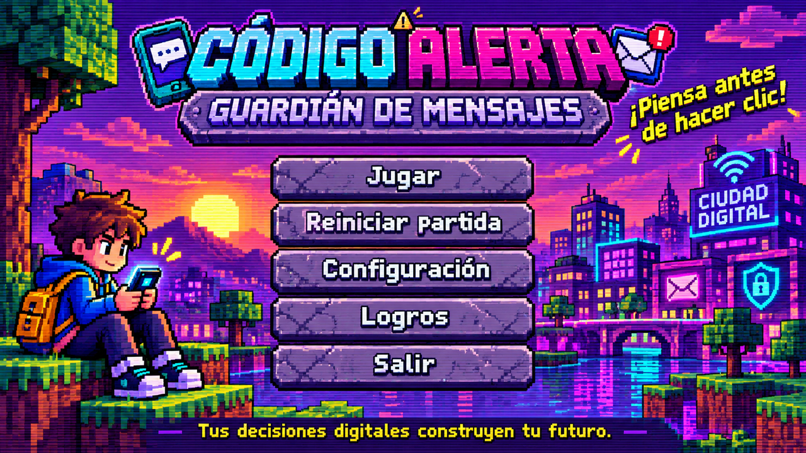
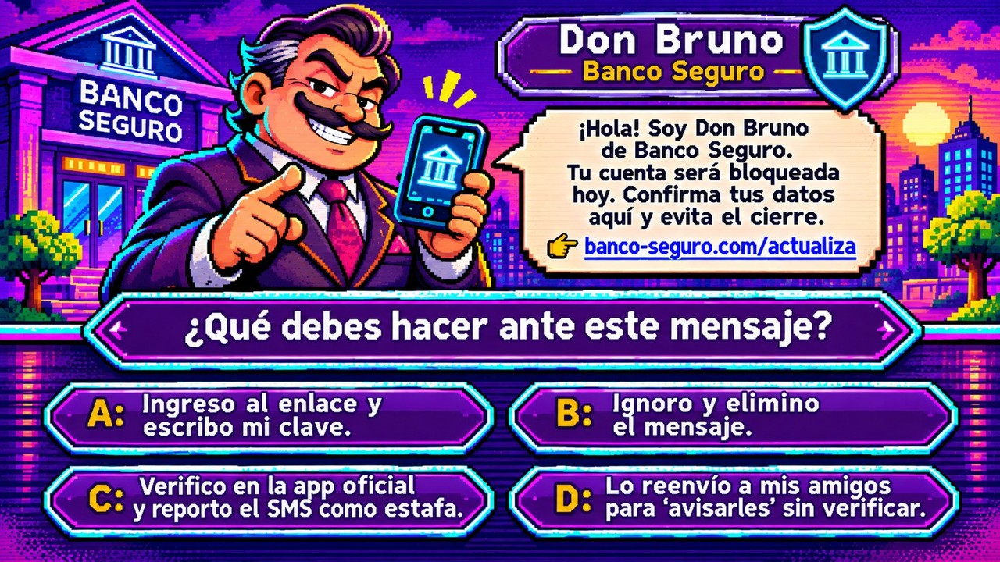
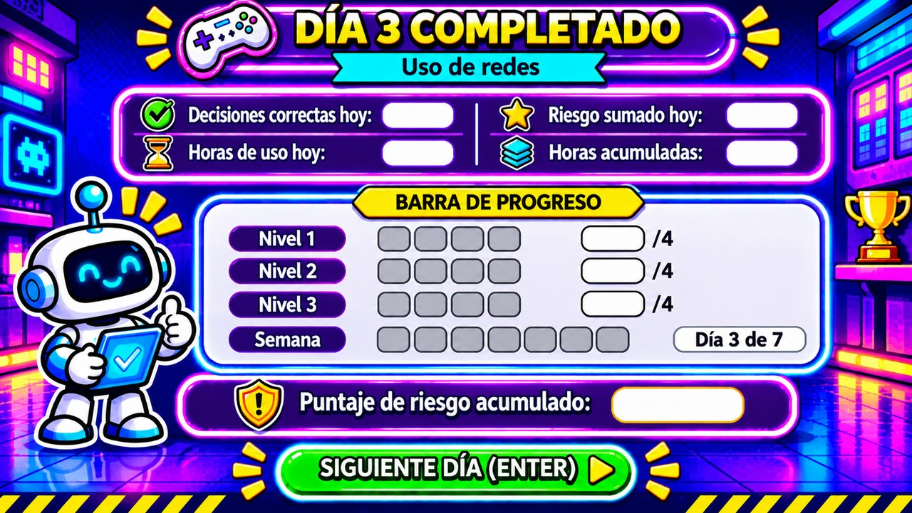

<p align="center">
  
</p>

# Código Alerta: Guardián de Mensajes

Videojuego educativo hecho en **Java con Processing** para aprender a detectar mensajes sospechosos, enlaces peligrosos y pedidos de datos personales.

> *Tus decisiones digitales construyen tu futuro.*

Proyecto del **Laboratorio Único – Feria Gamer 2026**, Algoritmia y Programación I, Universidad del Norte (semestre 2026_30, NRC 4510). Profesora: Rocío Ramos Rodríguez.

<p align="center">
  
</p>

## La historia

En **Ciudad Digital** todo pasa por el celular, incluidos los estafadores. Los profesores eligen a un estudiante como **Guardián de los Mensajes**, y ese estudiante eres tú. Tienes que sobrevivir una **semana digital de 7 días** y tomar **13 decisiones** sin caer en las trampas de villanos como Don Bruno Bancoseguro, Lola Sorteo o el Rey del Scroll Infinito.

## Características

- Registro de la sesión con validación de datos, años bisiestos, día de la semana y hora militar.
- Semana de 7 días con **3 niveles**: Principiante, Usuario Frecuente y Experto, este último con cuenta regresiva.
- **13 situaciones** ilustradas, una por personaje, con explicación de cada respuesta.
- Puntaje de riesgo según las decisiones, las horas de uso, el horario y el contenido consumido.
- Barra de progreso, **5 logros**, reporte final con estadísticas y bitácora de la semana.
- **4 finales**, uno de ellos secreto.
- Imágenes, música, sonidos, animaciones y pantalla completa.

<p align="center">
  
  
</p>

## Cómo ejecutarlo

1. Instala [Processing 4](https://processing.org/download).
2. Descarga este repositorio (botón **Code → Download ZIP**) y descomprímelo.
3. Abre `Lab_Entrega2_SHA_SEP_DRR_JPR/Lab_Entrega2_SHA_SEP_DRR_JPR.pde` con Processing.
4. Presiona **Run (▶)**.

No hace falta instalar librerías. La carpeta `data` debe quedar junto al archivo `.pde`.

## Controles

| Tecla | Acción |
|---|---|
| Clic | Presionar botones y opciones |
| ENTER | Confirmar o continuar |
| A, B, C, D / 1 a 8 | Elegir opciones |
| ESC | Volver atrás o pausar la partida |
| M | Silenciar o activar el sonido |

El manual completo está en [Manual_de_Usuario_Codigo_Alerta.pdf](Manual_de_Usuario_Codigo_Alerta.pdf).

## Estructura

```
Lab_Entrega2_SHA_SEP_DRR_JPR/
├── Lab_Entrega2_SHA_SEP_DRR_JPR.pde   código del juego
└── data/                              imágenes, fuente Poppins y sonidos
Manual_de_Usuario_Codigo_Alerta.pdf
logo.png
```

## Equipo 8

- Santiago Herrera Arévalo
- Samuel Eskaff Pérez
- Diego Andrés Rojano Retamozo
- Juan Parra Roa

## Créditos

- Fuente: [Poppins](https://fonts.google.com/specimen/Poppins), licencia SIL Open Font License.
- Música y sonido de clic: creados con código para este juego.
